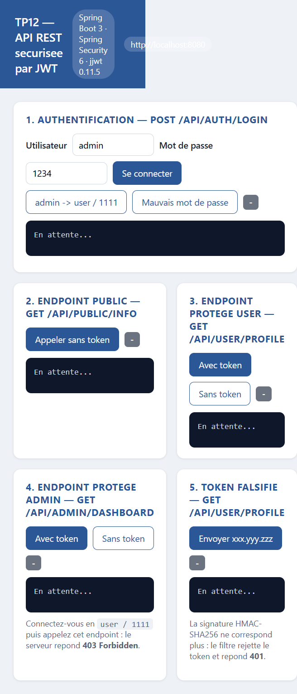
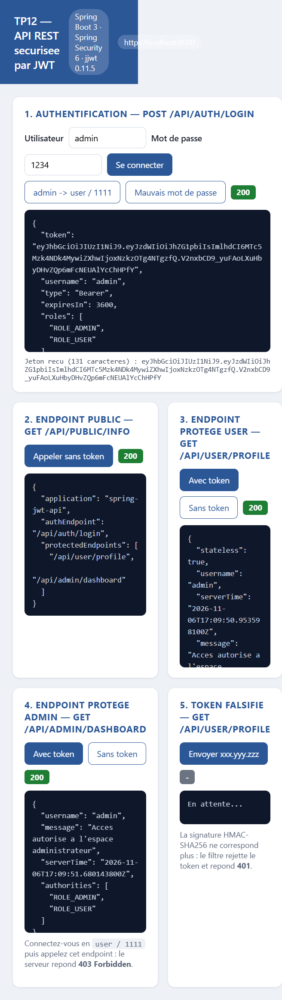
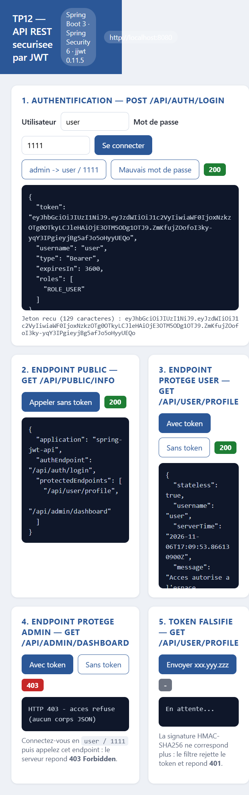
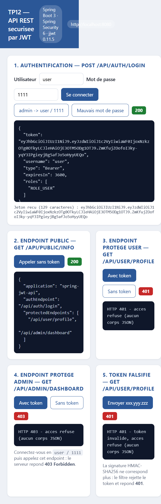
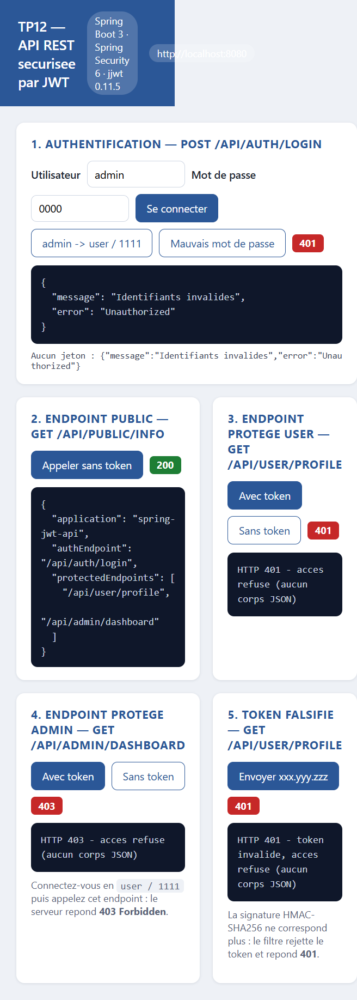

# TP12 — API REST sécurisée par JWT


> **Module** : Développement JakartaEE : Spring — **Cours 17**, TP n°12
> **Thème** : sécurité *stateless* d'une API REST avec JSON Web Token (JWT)
> **Auteure** : Yasmine Ait Halibi

---

## Table des matières

1. [Objectifs pédagogiques](#1-objectifs-pédagogiques)
2. [Le problème : session vs stateless](#2-le-problème--session-vs-stateless)
3. [Anatomie d'un JWT](#3-anatomie-dun-jwt)
4. [Architecture de l'application](#4-architecture-de-lapplication)
5. [Structure du projet](#5-structure-du-projet)
6. [Configuration](#6-configuration)
7. [Couche données : entités et repositories](#7-couche-données--entités-et-repositories)
8. [Génération et validation du token : `JwtUtil`](#8-génération-et-validation-du-token--jwtutil)
9. [Le filtre d'autorisation : `JwtAuthorizationFilter`](#9-le-filtre-dautorisation--jwtauthorizationfilter)
10. [Configuration de sécurité : `SecurityConfig`](#10-configuration-de-sécurité--securityconfig)
11. [Contrôleur d'authentification : `AuthController`](#11-contrôleur-dauthentification--authcontroller)
12. [Endpoints protégés](#12-endpoints-protégés)
13. [Scénarios de test vérifiés](#13-scénarios-de-test-vérifiés)
14. [Tests automatisés](#14-tests-automatisés)
15. [Base de données](#15-base-de-données)
16. [Lancer le projet](#16-lancer-le-projet)
17. [Points pédagogiques essentiels](#17-points-pédagogiques-essentiels)
18. [Limites et prolongements](#18-limites-et-prolongements)

---

## 1. Objectifs pédagogiques

À l'issue de ce TP, l'étudiant sait :

- expliquer la différence entre une authentification **par session** (stateful) et une authentification **par token** (stateless) ;
- décrire l'anatomie d'un JWT : *header*, *payload*, *signature* ;
- générer un token signé en **HMAC-SHA256** avec la bibliothèque `jjwt` ;
- écrire un **filtre Spring Security** qui lit l'en-tête `Authorization: Bearer …`, valide le token, recharge l'utilisateur et alimente le `SecurityContext` ;
- configurer une `SecurityFilterChain` en `SessionCreationPolicy.STATELESS`, sans CSRF ni formulaire de login ;
- distinguer **401 Unauthorized** (absence/validité du token) de **403 Forbidden** (token valide mais rôle insuffisant) ;
- tester une API sécurisée avec `curl`, un client graphique ou une page de test intégrée.

---

## 2. Le problème : session vs stateless

| Critère | Session (stateful) | JWT (stateless) |
|---|---|---|
| Où vit l'état ? | Sur le **serveur** (`HttpSession`) | Dans le **token**, chez le client |
| Envoi des preuves | Cookie `JSESSIONID` automatique | En-tête `Authorization: Bearer <token>` |
| Passage à l'échelle | Nécessite un *sticky session* ou un cache partagé (Redis) | Aucun stockage serveur : chaque instance peut valider le token |
| Révocation | Immédiate (destruction de session) | Difficile avant expiration (d'où les *refresh tokens* + *blacklist*) |
| CSRF | Risque élevé (cookie envoyé automatiquement) | Risque neutralisé (le navigateur n'ajoute pas l'en-tête tout seul) |
| Adapté à | Applications web à pages serveur | API REST, SPA, applications mobiles, microservices |

Le TP précédent (TP11) utilisait une session + formulaire de login. **Ici, plus aucune session n'est créée** : le serveur est une API pure qui délivre un token, puis le vérifie à chaque requête.

---

## 3. Anatomie d'un JWT

Un JWT est une chaîne `xxxxx.yyyyy.zzzzz` composée de trois segments encodés en **Base64URL**.

```
eyJhbGciOiJIUzI1NiJ9 . eyJzdWIiOiJ1c2VyIiwiaWF0IjoxNzkzOTg0NTY3LCJleHAiOjE3OTM5ODgxNjd9 . 8QQy25WHZIUh6JegmhpnWlA6vuBslORUT0CQN7XYLkM
└──── header ─────┘   └────────────────── payload ──────────────────┘   └──────────── signature ────────────┘
```

Décodage observé pendant la vérification (voir `docs/api-verification.txt`) :

```json
// header
{ "alg": "HS256" }

// payload
{ "sub": "user", "iat": 1793984567, "exp": 1793988167 }
```

| Segment | Contenu | Rôle |
|---|---|---|
| **header** | `alg`, éventuellement `typ` | Décrit l'algorithme de signature |
| **payload** (*claims*) | `sub` (sujet/utilisateur), `iat` (émis à), `exp` (expire à)… | Informations transportées |
| **signature** | `HMACSHA256(base64url(header) + "." + base64url(payload), cléSecrète)` | **Intégrité** : toute modification invalide la signature |

> ⚠️ **Le payload n'est pas chiffré**, seulement encodé : n'y mettez jamais de mot de passe ou de donnée sensible. La signature garantit qu'on ne peut pas le **modifier**, pas qu'on ne peut pas le **lire**.

C'est cette propriété qu'illustre le scénario 11 de la vérification : un token dont on a bricolé la signature est rejeté (401).

---

## 4. Architecture de l'application

```
                       ┌──────────────────────────────────────────────┐
   POST /api/auth/login│  AuthController                              │
   {user, password} ──►│   AuthenticationManager  ──► UserDetailsSvc  │
                       │   (vérifie le mot de passe BCrypt)           │
                       │   JwtUtil.generateToken(username)            │
                       └───────────────────┬──────────────────────────┘
                                           │ 200 { "token": "..." }
                                           ▼
                                    (client / Postman)

   GET /api/user/profile                   ┌────────────────────────────────────┐
   Authorization: Bearer <token> ─────────►│ JwtAuthorizationFilter             │
                                           │  1. extrait & valide la signature  │
                                           │  2. charge l'utilisateur + rôles   │
                                           │  3. remplit le SecurityContext     │
                                           └────────────────┬───────────────────┘
                                                            ▼
                                           ┌────────────────────────────────────┐
                                           │ SecurityFilterChain (règles d'URL) │
                                           │  /api/admin/** → hasRole(ADMIN)    │
                                           │  /api/user/**  → USER ou ADMIN     │
                                           └────────────────┬───────────────────┘
                                                            ▼
                                                      TestController
```

Séparation des responsabilités — c'est le cœur du TP :

| Composant | Responsabilité unique |
|---|---|
| `AuthController` | **Authentifier** et **émettre** le token |
| `JwtUtil` | **Fabriquer** et **valider** le token (crypto) |
| `JwtAuthorizationFilter` | **Vérifier** le token à chaque requête et peupler le contexte |
| `SecurityConfig` | **Décider** qui a le droit d'accéder à quelle URL |
| `CustomUserDetailsService` | **Charger** l'utilisateur et ses rôles depuis la base |

---

## 5. Structure du projet

```
tp12-spring-jwt/
├── pom.xml
├── README.md
├── docs/
│   ├── api-verification.txt      # transcription des 14 scénarios curl
│   ├── build.log                 # mvn clean package
│   ├── tests.log                 # mvn test (21 tests)
│   ├── verify.ps1                # script de vérification reproductible
│   └── images/                   # captures d'écran
└── src/
    ├── main/
    │   ├── java/ma/ens/security/
    │   │   ├── SpringJwtApiApplication.java
    │   │   ├── config/
    │   │   │   ├── SecurityConfig.java
    │   │   │   └── DatabaseInitializer.java
    │   │   ├── entities/
    │   │   │   ├── Role.java
    │   │   │   └── User.java
    │   │   ├── repositories/
    │   │   │   ├── RoleRepository.java
    │   │   │   └── UserRepository.java
    │   │   ├── services/
    │   │   │   └── CustomUserDetailsService.java
    │   │   ├── jwt/
    │   │   │   ├── JwtUtil.java
    │   │   │   └── JwtAuthorizationFilter.java
    │   │   └── web/
    │   │       ├── AuthController.java
    │   │       └── TestController.java
    │   └── resources/
    │       ├── application.properties
    │       └── static/tester.html      # interface de test (fetch)
    └── test/
        ├── java/ma/ens/security/
        │   ├── JwtUtilTest.java        # 8 tests unitaires
        │   └── AuthApiTest.java        # 13 tests d'intégration
        └── resources/application-test.properties
```

---

## 6. Configuration

`src/main/resources/application.properties` :

```properties
spring.application.name=spring-jwt-api
server.port=8080

# Base de données MySQL
spring.datasource.url=jdbc:mysql://localhost:3306/security_jwt?useSSL=false&serverTimezone=UTC&createDatabaseIfNotExist=true
spring.datasource.username=root
spring.datasource.password=
spring.jpa.hibernate.ddl-auto=update
spring.jpa.show-sql=true

# Paramètres JWT
jwt.secret=MySuperSecretKeyForJwtAuthentication123456
jwt.expiration=3600000
```

| Propriété | Rôle |
|---|---|
| `jwt.secret` | Clé symétrique HMAC. **En production** : au moins 256 bits, générée aléatoirement, stockée en variable d'environnement ou dans un coffre-fort (Vault, AWS Secrets Manager) — jamais dans Git. |
| `jwt.expiration` | Durée de vie en millisecondes. `3 600 000` = **1 heure**, exposée au client sous forme `expiresIn: 3600` (secondes). |

`pom.xml` — dépendances clés :

```xml
<dependency>
  <groupId>org.springframework.boot</groupId>
  <artifactId>spring-boot-starter-security</artifactId>
</dependency>
<dependency>
  <groupId>io.jsonwebtoken</groupId>
  <artifactId>jjwt-api</artifactId>
  <version>0.11.5</version>
</dependency>
<dependency>
  <groupId>io.jsonwebtoken</groupId>
  <artifactId>jjwt-impl</artifactId>
  <version>0.11.5</version>
  <scope>runtime</scope>
</dependency>
<dependency>
  <groupId>io.jsonwebtoken</groupId>
  <artifactId>jjwt-jackson</artifactId>
  <version>0.11.5</version>
  <scope>runtime</scope>
</dependency>
```

---

## 7. Couche données : entités et repositories

`User` et `Role` reprennent le modèle du TP11 (relation `@ManyToMany`), avec deux précautions propres à Lombok :

```java
@Entity
@Table(name = "user")
@Getter @Setter @NoArgsConstructor
@ToString(exclude = "roles")          // évite la récursion infinie User ↔ Role
@EqualsAndHashCode(exclude = "roles")
public class User {
    @Id @GeneratedValue(strategy = GenerationType.IDENTITY)
    private Long id;

    @Column(nullable = false, unique = true, length = 50)
    private String username;

    @Column(nullable = false, length = 100)
    private String password;           // hash BCrypt

    private boolean enabled = true;

    @ManyToMany(fetch = FetchType.EAGER)
    @JoinTable(name = "user_roles",
               joinColumns = @JoinColumn(name = "user_id"),
               inverseJoinColumns = @JoinColumn(name = "role_id"))
    private Set<Role> roles = new HashSet<>();
}
```

`EAGER` est volontaire : le `JwtAuthorizationFilter` a besoin des rôles immédiatement pour construire les autorités, hors de toute transaction ouverte.

---

## 8. Génération et validation du token : `JwtUtil`

```java
@Component
public class JwtUtil {

    private final SecretKey key;
    private final long expiration;

    public JwtUtil(@Value("${jwt.secret}") String secret,
                   @Value("${jwt.expiration}") long expiration) {
        this.key = Keys.hmacShaKeyFor(secret.getBytes(StandardCharsets.UTF_8));
        this.expiration = expiration;
    }

    public String generateToken(String username) {
        Date now = new Date();
        return Jwts.builder()
                .setSubject(username)
                .setIssuedAt(now)
                .setExpiration(new Date(now.getTime() + expiration))
                .signWith(key, SignatureAlgorithm.HS256)
                .compact();
    }

    public String extractUsername(String token) {
        return parse(token).getSubject();
    }

    public boolean validateToken(String token) {
        try {
            parse(token);
            return true;
        } catch (JwtException | IllegalArgumentException e) {
            return false;
        }
    }

    private Claims parse(String token) {
        return Jwts.parserBuilder()
                .setSigningKey(key)
                .build()
                .parseClaimsJws(token)
                .getBody();
    }
}
```

Points à retenir :

- `Keys.hmacShaKeyFor(...)` exige une clé d'au moins **256 bits** (32 caractères) pour HS256, sinon `WeakKeyException`.
- `parseClaimsJws` **vérifie la signature et l'expiration** en une seule opération : un token expiré lève `ExpiredJwtException`, une signature incorrecte `SignatureException`.
- `validateToken` **ne lève jamais** d'exception : il renvoie `false`, ce qui simplifie l'usage dans le filtre.

---

## 9. Le filtre d'autorisation : `JwtAuthorizationFilter`

```java
@Component
public class JwtAuthorizationFilter extends OncePerRequestFilter {

    private final JwtUtil jwtUtil;
    private final UserDetailsService userDetailsService;

    @Override
    protected void doFilterInternal(HttpServletRequest request,
                                    HttpServletResponse response,
                                    FilterChain filterChain)
            throws ServletException, IOException {

        String header = request.getHeader("Authorization");

        if (header != null && header.startsWith("Bearer ")) {
            String token = header.substring(7);
            try {
                String username = jwtUtil.extractUsername(token);

                if (username != null && jwtUtil.validateToken(token)
                        && SecurityContextHolder.getContext().getAuthentication() == null) {
                    UserDetails user = userDetailsService.loadUserByUsername(username);
                    var authentication = new UsernamePasswordAuthenticationToken(
                            user, null, user.getAuthorities());
                    SecurityContextHolder.getContext().setAuthentication(authentication);
                }
            } catch (Exception e) {
                SecurityContextHolder.clearContext();   // token invalide → anonyme
            }
        }
        filterChain.doFilter(request, response);
    }
}
```

| Ligne | Pourquoi |
|---|---|
| `OncePerRequestFilter` | Garantit une seule exécution par requête (même en cas de *forward* interne). |
| `header.startsWith("Bearer ")` | Convention RFC 6750 ; `substring(7)` retire le préfixe. |
| `getAuthentication() == null` | Ne réécrase pas une authentification déjà positionnée. |
| `new UsernamePasswordAuthenticationToken(user, null, authorities)` | Constructeur à 3 arguments = **authentifié** (le 2-arg crée un token non authentifié). |
| `catch → clearContext()` | Un token corrompu ne doit pas laisser un contexte sale ; la requête continue en anonyme et sera refusée plus loin. |
| `filterChain.doFilter(...)` | **Toujours** appeler la suite, même sans token : c'est la chaîne d'autorisation qui décide. |

---

## 10. Configuration de sécurité : `SecurityConfig`

```java
@Bean
public SecurityFilterChain securityFilterChain(HttpSecurity http) throws Exception {
    http
        .csrf(csrf -> csrf.disable())                                   // 1
        .sessionManagement(s -> s.sessionCreationPolicy(STATELESS))      // 2
        .authorizeHttpRequests(auth -> auth
            .dispatcherTypeMatchers(DispatcherType.ERROR).permitAll()    // 3
            .requestMatchers("/api/auth/**", "/api/public/**").permitAll()
            .requestMatchers("/tester.html", "/favicon.ico").permitAll()
            .requestMatchers("/api/admin/**").hasRole("ADMIN")
            .requestMatchers("/api/user/**").hasAnyRole("USER", "ADMIN")
            .anyRequest().authenticated()
        )
        .exceptionHandling(ex -> ex
            .authenticationEntryPoint(new HttpStatusEntryPoint(HttpStatus.UNAUTHORIZED)))  // 4
        .addFilterBefore(jwtFilter, UsernamePasswordAuthenticationFilter.class);          // 5

    return http.build();
}
```

1. **CSRF désactivé** : sans cookie de session, un attaquant ne peut pas rejouer l'authentification d'un utilisateur ; le token CSRF n'a plus de sens.
2. **`STATELESS`** : Spring Security ne crée ni ne lit jamais de `HttpSession`. Combiné à `csrf.disable()`, aucune donnée d'état n'est conservée.
3. **`DispatcherType.ERROR` autorisé** — subtilité découverte pendant la mise au point. Quand un `USER` attaque `/api/admin/**`, Spring lève `AccessDeniedException`, puis le conteneur fait un *dispatch* interne vers `/error`. Ce second passage **ne porte pas** l'en-tête `Authorization` ; sans cette ligne, `anyRequest().authenticated()` rejetait la requête d'erreur et l'`authenticationEntryPoint` transformait le **403 en 401**. Cette règle préserve la sémantique HTTP correcte.
4. **`HttpStatusEntryPoint`** : par défaut, Spring Security redirigerait vers `/login` — comportement inadapté à une API. On renvoie un simple **401** sans corps.
5. **Placement du filtre** : avant `UsernamePasswordAuthenticationFilter`, c'est-à-dire avant tout mécanisme d'authentification classique, afin que le contexte soit prêt quand les règles d'autorisation s'appliquent.

`hasRole("ADMIN")` attend en réalité l'autorité `ROLE_ADMIN` : c'est `CustomUserDetailsService` qui ajoute ce préfixe via `SimpleGrantedAuthority`.

---

## 11. Contrôleur d'authentification : `AuthController`

```java
@RestController
@RequestMapping("/api/auth")
public class AuthController {

    private final AuthenticationManager authenticationManager;
    private final JwtUtil jwtUtil;
    private final CustomUserDetailsService userDetailsService;

    public record LoginRequest(@NotBlank String username, @NotBlank String password) {}

    @PostMapping("/login")
    public ResponseEntity<?> login(@Valid @RequestBody LoginRequest request) {
        try {
            authenticationManager.authenticate(
                    new UsernamePasswordAuthenticationToken(request.username(), request.password()));
        } catch (BadCredentialsException e) {
            return ResponseEntity.status(HttpStatus.UNAUTHORIZED)
                    .body(Map.of("error", "Unauthorized", "message", "Identifiants invalides"));
        }

        UserDetails user = userDetailsService.loadUserByUsername(request.username());
        String token = jwtUtil.generateToken(user.getUsername());
        List<String> roles = user.getAuthorities().stream()
                .map(GrantedAuthority::getAuthority).toList();

        return ResponseEntity.ok(Map.of(
                "token", token,
                "username", user.getUsername(),
                "type", "Bearer",
                "expiresIn", jwtUtil.getExpirationMillis() / 1000,
                "roles", roles));
    }
}
```

L'`AuthenticationManager` réutilise `CustomUserDetailsService` + `BCryptPasswordEncoder` pour vérifier le mot de passe ; le filtre, lui, ne revérifie **pas** le mot de passe (le token suffit).

---

## 12. Endpoints protégés

| Méthode | URL | Accès | Réponse |
|---|---|---|---|
| `POST` | `/api/auth/login` | public | `200` + `{token, username, type, expiresIn, roles}` / `401` si identifiants invalides |
| `GET` | `/api/public/info` | public | `200` + description de l'API |
| `GET` | `/api/user/profile` | `ROLE_USER` **ou** `ROLE_ADMIN` | `200` + `{message, username, authorities, stateless, serverTime}` |
| `GET` | `/api/admin/dashboard` | `ROLE_ADMIN` uniquement | `200` + `{message, username, authorities, serverTime}` |
| `GET` | `/tester.html` | public | interface de test (page statique) |

Rappel de la règle de composition : comme `admin` possède `ROLE_ADMIN` **et** `ROLE_USER`, il accède aux deux espaces ; `user` n'accède qu'à `/api/user/**`.

---

## 13. Scénarios de test vérifiés

Transcription complète dans [`docs/api-verification.txt`](docs/api-verification.txt), reproductible avec [`docs/verify.ps1`](docs/verify.ps1). Résultats observés sur l'application réellement démarrée :

| # | Scénario | Attendu | Observé |
|---|---|---|---|
| 1 | `GET /api/public/info` sans token | 200 | ✅ 200 |
| 2 | `POST /api/auth/login` `admin/1234` | 200 + token | ✅ 200, rôles `ROLE_ADMIN`, `ROLE_USER` |
| 3 | `POST /api/auth/login` `user/1111` | 200 + token | ✅ 200, rôle `ROLE_USER` |
| 4 | `POST /api/auth/login` `admin/0000` | 401 | ✅ 401 `Identifiants invalides` |
| 5 | `GET /api/user/profile` sans token | 401 | ✅ 401 |
| 6 | `GET /api/user/profile` token de `user` | 200 | ✅ 200 |
| 7 | `GET /api/admin/dashboard` token de `user` | **403** | ✅ 403 |
| 8 | `GET /api/admin/dashboard` token de `admin` | 200 | ✅ 200 |
| 9 | `GET /api/user/profile` token de `admin` | 200 | ✅ 200 |
| 10 | Token invalide `xxx.yyy.zzz` | 401 | ✅ 401 |
| 11 | Token dont la signature a été falsifiée | 401 | ✅ 401 |
| 12 | Décodage du token de `user` | header/payload lisibles | ✅ `{"alg":"HS256"}` / `{"sub":"user",...}` |
| 13 | Décodage du token de `admin` | payload `sub=admin` | ✅ |
| 14 | Aucun `Set-Cookie` renvoyé | API stateless | ✅ (aucune session) |

### Captures d'écran

| Interface de test | Admin : 200 partout |
|---|---|
|  |  |

| User sur `/api/admin/dashboard` → 403 | Sans token / token falsifié → 401 |
|---|---|
|  |  |

| Mauvais mot de passe → 401 |
|---|
|  |

La page [`src/main/resources/static/tester.html`](src/main/resources/static/tester.html) est une interface autonome (aucun framework) qui exécute les mêmes appels en `fetch` : pratique pour la démonstration orale, sans dépendre de Postman.

### Équivalents `curl`

```bash
# 1. Obtenir un token
curl -s -X POST http://localhost:8080/api/auth/login \
     -H 'Content-Type: application/json' \
     -d '{"username":"admin","password":"1234"}'

# 2. Appeler un endpoint protégé
TOKEN=<token renvoyé ci-dessus>
curl -s -H "Authorization: Bearer $TOKEN" http://localhost:8080/api/user/profile

# 3. Tentative avec un rôle insuffisant (user sur /api/admin)
curl -i -H "Authorization: Bearer $TOKEN_USER" http://localhost:8080/api/admin/dashboard
# HTTP/1.1 403
```

---

## 14. Tests automatisés

`mvn test` → **21 tests, 0 échec**.

| Classe | Nb | Couverture |
|---|---|---|
| `JwtUtilTest` | 8 | génération, `sub`, unicité, validation, signature falsifiée, token malformé, token expiré, `exp` cohérent |
| `AuthApiTest` | 13 | login admin/user, mauvais mot de passe, JSON invalide, endpoint public, accès sans token, accès USER, **403 USER sur admin**, accès ADMIN, ADMIN sur `/api/user`, token invalide, token falsifié, cohérence `JwtUtil` ↔ API |

Extrait des scénarios d'intégration (MockMvc) :

```java
@Test
@DisplayName("Un USER est refuse sur /api/admin/dashboard (403)")
void userIsForbiddenOnAdminEndpoint() throws Exception {
    String token = login("user", "1111");
    mockMvc.perform(get("/api/admin/dashboard").header("Authorization", "Bearer " + token))
           .andExpect(status().isForbidden());
}

@Test
@DisplayName("Le token ne contient pas le mot de passe")
void tokenDoesNotLeakPassword() {
    String token = jwtUtil.generateToken("admin");
    String payload = new String(Base64.getUrlDecoder().decode(token.split("\\.")[1]));
    assertThat(payload).doesNotContain("1234");
}
```

Exécution :

```bash
mvn test          # tests seuls
mvn clean package # tests + jar exécutable
```

Journal complet : [`docs/tests.log`](docs/tests.log) et [`docs/build.log`](docs/build.log).

---

## 15. Base de données

Base MySQL `security_jwt`, schéma généré par Hibernate (`ddl-auto=update`) :

```
┌──────────────┐        ┌──────────────┐        ┌──────────────┐
│   user       │        │  user_roles  │        │    role      │
├──────────────┤        ├──────────────┤        ├──────────────┤
│ id (PK)      │◄───────│ user_id (FK) │        │ id (PK)      │
│ username (U) │        │ role_id (FK) │───────►│ name (U)     │
│ password     │        └──────────────┘        └──────────────┘
│ enabled      │
└──────────────┘
```

Comptes créés au démarrage par `DatabaseInitializer` (opération **idempotente** — `if (userRepo.count() > 0) return;`) :

| Utilisateur | Mot de passe | Rôles |
|---|---|---|
| `admin` | `1234` | `ROLE_ADMIN`, `ROLE_USER` |
| `user` | `1111` | `ROLE_USER` |

Les mots de passe sont hachés en **BCrypt** (`$2a$10$…`) — vérifiable dans la base avec `SELECT username, password FROM user;`.

---

## 16. Lancer le projet

### Prérequis

- JDK 17+
- Maven 3.8+
- MySQL / MariaDB sur `localhost:3306`

### Étapes

```bash
# 1. (optionnel) créer la base — sinon createDatabaseIfNotExist s'en charge
mysql -u root -e "CREATE DATABASE IF NOT EXISTS security_jwt;"

# 2. compiler et tester
mvn clean package

# 3. démarrer
java -jar target/spring-jwt-api-1.0.0.jar

# 4. ouvrir l'interface de test
#    http://localhost:8080/tester.html
```

### Vérification rapide

```bash
curl -s http://localhost:8080/api/public/info
# {"application":"spring-jwt-api","authEndpoint":"/api/auth/login",
#  "protectedEndpoints":["/api/user/profile","/api/admin/dashboard"]}
```

---

## 17. Points pédagogiques essentiels

| Concept | Description |
|---|---|
| **Stateless** | Aucune session : le token suffit pour chaque requête. Le serveur peut être répliqué sans coordination. |
| **Token signé** | Vérifiable mais non modifiable (garantie d'intégrité par HMAC-SHA256). |
| **Filtre JWT** | Cœur du mécanisme : vérifie la validité du token à chaque requête. |
| **Séparation des responsabilités** | `AuthController` → login, `JwtFilter` → autorisation, `SecurityConfig` → configuration globale. |
| **Sécurité renforcée** | Même sans base de session, Spring Security applique le contrôle des rôles et privilèges. |
| **401 ≠ 403** | 401 = « je ne sais pas qui vous êtes » ; 403 = « je sais qui vous êtes, mais vous n'avez pas le droit ». |
| **Payload lisible** | Le JWT n'est pas chiffré : n'y stockez jamais de secret. |

---

## 18. Limites et prolongements

Ce qui manque volontairement à ce TP, et qui constitue la suite logique du cours :

| Limite | Prolongement |
|---|---|
| Pas de révocation avant expiration | *Refresh tokens* + rotation de clés + liste de révocation (`jti` en base ou Redis) |
| Clé HMAC unique en dur | Rotation de clés (`kid` dans le header), asymétrique RS256, coffre-fort de secrets |
| Pas de renouvellement | Endpoint `/api/auth/refresh` avec un token de courte durée (15 min) + refresh token (7 jours) |
| Pas de fournisseur d'identité externe | **OAuth2 / OpenID Connect** — c'est précisément l'objet du **TP13** (Google et Keycloak) |
| Pas de gestion fine des permissions | `@PreAuthorize` + permissions granulaires, *scopes* OAuth2 |
| Pas de journalisation d'audit | Tracer les connexions, les échecs et les accès refusés |

---

## Licence

Projet pédagogique réalisé dans le cadre du module **Développement JakartaEE : Spring** — libre de réutilisation à des fins d'apprentissage.
